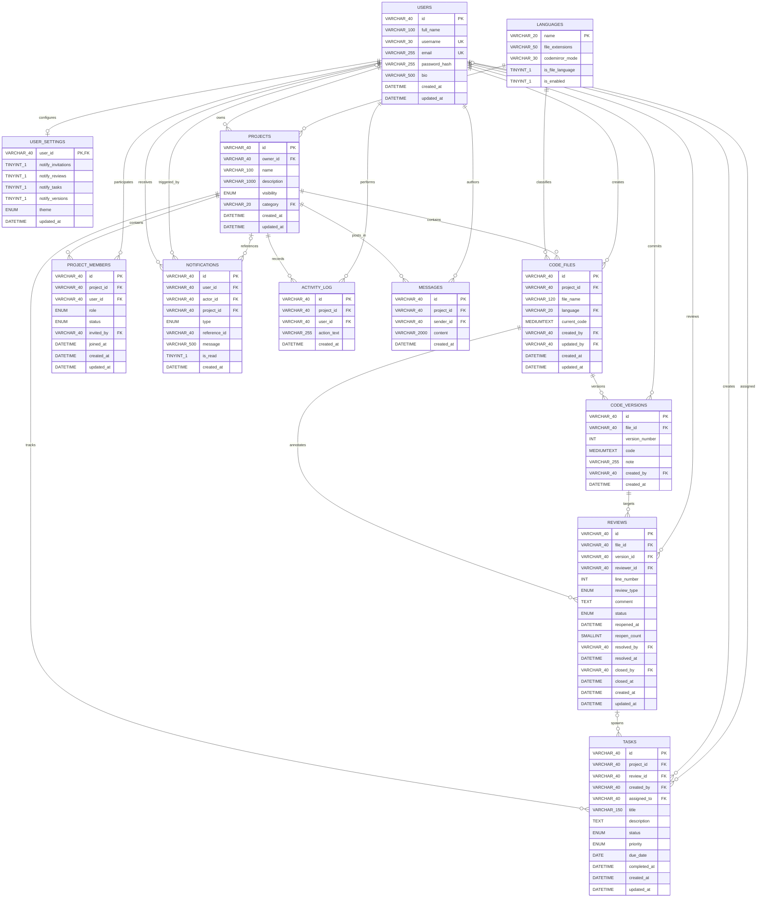

# CodeReviewHub — Database Architecture & Design Specification (MySQL 8.0)

## 1. Principles and Locked Decisions

This document defines the relational database design for **CodeReviewHub**, migrating from the initial in-memory prototype (`store.js`) to a robust, transactional **MySQL 8.0+** schema.

### 1.1 Locked Architectural Decisions
1. **Identifier Strategy**:
   - Primary keys and foreign keys are strings: `VARCHAR(40) CHARACTER SET ascii COLLATE ascii_bin` (case-sensitive binary ASCII).
   - Seed data IDs are preserved as-is (`'u1'`, `'p1'`, `'v_f2_1'`, etc.).
   - All newly generated IDs follow `<prefix>_<uuid>` produced by `backend/utils/id.js`, with standard prefixes: `u_`, `p_`, `m_`, `f_`, `v_`, `r_`, `t_`, `n_`, `a_`, `msg_` (maximum length 40 characters).
2. **Review Lifecycle Invariants**:
   - Statuses are strictly: `open`, `resolved`, `closed`.
   - Permitted state transitions and authorization:
     - `open -> resolved`: Project owner or accepted collaborator.
     - `resolved -> open`: Project owner or accepted collaborator.
     - `resolved -> closed`: Project owner only.
     - `closed -> open`: Project owner only.
   - Any other transition is rejected with HTTP 409 (`"A review cannot move from X to Y."`). Wrong role rejected with HTTP 403.
   - Bookkeeping timestamps:
     - Resolving sets `resolved_by` and `resolved_at`.
     - Closing sets `closed_by` and `closed_at` (retaining `resolved_*`).
     - Reopening sets `status = 'open'`, resets `resolved_*` and `closed_*` to `NULL`, sets `reopened_at = CURRENT_TIMESTAMP`, and increments `reopen_count`.
3. **Viewer Role Derivation**:
   - The `viewer` role is **never stored** in `project_members`.
   - It is dynamically derived: project has `visibility = 'public'` AND the querying user has no accepted row in `project_members`.
4. **Canonical Ownership & Owner Member Invariant**:
   - `projects.owner_id` is the canonical owner.
   - In MySQL, creating a project also creates a row in `project_members` with `role = 'owner'` and `status = 'accepted'` in the exact same transaction (PRD BR-002).
   - The two must never disagree.
5. **Delete & Cascade Behavior**:
   - Deleting a project cascades and deletes all owned entities: members, files, versions, reviews, tasks, notifications, activity log, and messages.
   - Deleting a file cascades and deletes its versions and reviews; tasks that originated from those reviews **SURVIVE** with `review_id` set to `NULL`.
   - Users are never hard-deleted (`ON DELETE RESTRICT` protects audit trails and attribution).
6. **Decoupled Task Creation**:
   - Creating a task from a review does **not** auto-resolve the review (LOCKED DECISION 6).
7. **Invitation Lifecycle & Notifications**:
   - Responding to an invitation keeps the invitation notification (marked `is_read = 1`) and sends a new notification to the inviter (`"<name> accepted/declined your invitation to <project>"`).
   - Re-inviting a rejected member updates the existing row back to `status = 'pending'`, clearing `joined_at` and setting a new `invited_by`.
8. **API Compatibility**:
   - All REST URLs, parameter names, and response JSON field shapes remain 100% backward-compatible.
   - `due_date` is strictly returned as `'YYYY-MM-DD'` string (configured via mysql2 option `dateStrings: ['DATE']`).
   - Timestamps are UTC and formatted as ISO 8601 strings.

---

## 2. Entity-Relationship (ER) Diagram



---

## 3. Table Dictionary & Status Classification

Every column is classified as **USED** (actively consumed/written by existing code), **PLANNED** (architected for forthcoming features), or **DERIVED** (computed at runtime).

### 3.1 `users`
| Column | Type | Constraints | Source Field / Mapping | Status | Notes |
| :--- | :--- | :--- | :--- | :--- | :--- |
| `id` | `VARCHAR(40)` | PK, `ascii_bin` | `seed.js users[].id`, `authService`, `userService` | **USED** | Seed ids preserved; new ids use `u_<uuid>` |
| `full_name` | `VARCHAR(100)` | NOT NULL, `CHECK (CHAR_LENGTH(TRIM(full_name)) > 0)` | `seed.js name` / `full_name` | **USED** | User display name |
| `username` | `VARCHAR(30)` | UNIQUE, NOT NULL, `CHECK (username REGEXP '^[A-Za-z0-9_]{3,30}$')` | `seed.js username` | **USED** | Unique handle |
| `email` | `VARCHAR(255)` | UNIQUE, NOT NULL | `seed.js email` | **USED** | Lowercase email address |
| `password_hash`| `VARCHAR(255)` | NOT NULL | `seed.js password` | **USED** | Salted bcrypt hash |
| `bio` | `VARCHAR(500)` | NULL | `seed.js bio` | **USED** | User profile bio |
| `created_at` | `DATETIME` | NOT NULL, DEFAULT CURRENT_TIMESTAMP | `seed.js created_at` | **USED** | UTC creation timestamp |
| `updated_at` | `DATETIME` | NOT NULL, ON UPDATE CURRENT_TIMESTAMP | Runtime timestamp | **USED** | UTC last update timestamp |

### 3.2 `user_settings`
| Column | Type | Constraints | Source Field / Mapping | Status | Notes |
| :--- | :--- | :--- | :--- | :--- | :--- |
| `user_id` | `VARCHAR(40)` | PK, FK `users(id)` ON DELETE CASCADE | New table | **PLANNED** | 1:1 user preferences |
| `notify_invitations` | `TINYINT(1)` | NOT NULL DEFAULT 1 | New | **PLANNED** | Email/UI alert pref |
| `notify_reviews` | `TINYINT(1)` | NOT NULL DEFAULT 1 | New | **PLANNED** | Notification toggle |
| `notify_tasks` | `TINYINT(1)` | NOT NULL DEFAULT 1 | New | **PLANNED** | Notification toggle |
| `notify_versions` | `TINYINT(1)` | NOT NULL DEFAULT 1 | New | **PLANNED** | Notification toggle |
| `theme` | `ENUM('light','dark')` | NOT NULL DEFAULT 'light' | New | **PLANNED** | Theme toggle preference |
| `updated_at` | `DATETIME` | NOT NULL, ON UPDATE CURRENT_TIMESTAMP | Runtime timestamp | **PLANNED** | Preference update time |

### 3.3 `languages`
| Column | Type | Constraints | Source Field / Mapping | Status | Notes |
| :--- | :--- | :--- | :--- | :--- | :--- |
| `name` | `VARCHAR(20)` | PK | `seed.js languages[].name` | **USED** | e.g., 'C', 'Java', 'Python', 'Mixed' |
| `file_extensions` | `VARCHAR(50)` | NOT NULL DEFAULT '' | `seed.js languages[].file_extensions` | **USED** | e.g., '.c,.h', '.java' |
| `codemirror_mode` | `VARCHAR(30)` | NULL | `seed.js languages[].codemirror_mode` | **USED** | Frontend syntax highlighter mode |
| `is_file_language`| `TINYINT(1)` | NOT NULL DEFAULT 1 | `seed.js languages[].is_file_language` | **USED** | 0 for project-only categories ('Mixed') |
| `is_enabled` | `TINYINT(1)` | NOT NULL DEFAULT 1 | Default | **USED** | Soft enable/disable |

### 3.4 `projects`
| Column | Type | Constraints | Source Field / Mapping | Status | Notes |
| :--- | :--- | :--- | :--- | :--- | :--- |
| `id` | `VARCHAR(40)` | PK, `ascii_bin` | `seed.js projects[].id` | **USED** | Seed ids preserved; new ids use `p_<uuid>` |
| `owner_id` | `VARCHAR(40)` | FK `users(id)` ON DELETE RESTRICT | `seed.js projects[].owner_id` | **USED** | Canonical owner |
| `name` | `VARCHAR(100)` | NOT NULL, `CHECK (CHAR_LENGTH(TRIM(name)) > 0)` | `seed.js projects[].name` | **USED** | Project name |
| `description` | `VARCHAR(1000)` | NOT NULL DEFAULT '' | `seed.js projects[].description` | **USED** | Markdown/text summary |
| `visibility` | `ENUM('public','private')` | NOT NULL DEFAULT 'public' | `seed.js projects[].visibility` | **USED** | Visibility control |
| `category` | `VARCHAR(20)` | FK `languages(name)` ON UPDATE CASCADE | `seed.js projects[].category` | **USED** | Language category |
| `created_at` | `DATETIME` | NOT NULL, DEFAULT CURRENT_TIMESTAMP | `seed.js projects[].created_at` | **USED** | UTC creation timestamp |
| `updated_at` | `DATETIME` | NOT NULL, ON UPDATE CURRENT_TIMESTAMP | `seed.js projects[].updated_at` | **USED** | UTC last touch timestamp |
| *membersCount* | Integer | Computed via subquery | Computed | **DERIVED** | Accepted members + owner |
| *filesCount* | Integer | Computed via subquery | Computed | **DERIVED** | Total project files |
| *openReviewsCount* | Integer | Computed via subquery | Computed | **DERIVED** | Total reviews with `status = 'open'` |
| *role* | String | Computed via authorization rules | Computed | **DERIVED** | `'owner'`, `'collaborator'`, or `'viewer'` |

### 3.5 `project_members`
| Column | Type | Constraints | Source Field / Mapping | Status | Notes |
| :--- | :--- | :--- | :--- | :--- | :--- |
| `id` | `VARCHAR(40)` | PK, `ascii_bin` | `seed.js project_members[].id` | **USED** | Prefix `m_<uuid>` |
| `project_id` | `VARCHAR(40)` | FK `projects(id)` ON DELETE CASCADE | `seed.js project_members[].project_id`| **USED** | Parent project |
| `user_id` | `VARCHAR(40)` | FK `users(id)` ON DELETE CASCADE | `seed.js project_members[].user_id` | **USED** | Member user |
| `role` | `ENUM('owner','collaborator')` | NOT NULL DEFAULT 'collaborator' | `seed.js project_members[].role` | **USED** | Member role ('viewer' not stored) |
| `status` | `ENUM('pending','accepted','rejected')` | NOT NULL DEFAULT 'pending' | `seed.js project_members[].status` | **USED** | Member status |
| `invited_by` | `VARCHAR(40)` | FK `users(id)` ON DELETE SET NULL | `seed.js project_members[].invited_by`| **USED** | Inviter user |
| `joined_at` | `DATETIME` | NULL, `CHECK (status <> 'accepted' OR joined_at IS NOT NULL)` | `seed.js project_members[].joined_at` | **USED** | Required when status='accepted' |
| `created_at` | `DATETIME` | NOT NULL, DEFAULT CURRENT_TIMESTAMP | `seed.js project_members[].created_at` | **USED** | Invitation timestamp |
| `updated_at` | `DATETIME` | NOT NULL, ON UPDATE CURRENT_TIMESTAMP | Runtime timestamp | **USED** | Status change timestamp |

### 3.6 `code_files`
| Column | Type | Constraints | Source Field / Mapping | Status | Notes |
| :--- | :--- | :--- | :--- | :--- | :--- |
| `id` | `VARCHAR(40)` | PK, `ascii_bin` | `seed.js files[].id` | **USED** | Prefix `f_<uuid>` |
| `project_id` | `VARCHAR(40)` | FK `projects(id)` ON DELETE CASCADE | `seed.js files[].project_id` | **USED** | Parent project |
| `file_name` | `VARCHAR(120)` | NOT NULL, `UNIQUE (project_id, file_name)`, `CHECK (CHAR_LENGTH(TRIM(file_name)) > 0)` | `seed.js files[].name` / `file_name` | **USED** | File path within project |
| `language` | `VARCHAR(20)` | FK `languages(name)` ON UPDATE CASCADE | `seed.js files[].language` | **USED** | Language identifier |
| `current_code`| `MEDIUMTEXT` | NOT NULL | `seed.js files[].code` / `current_code`| **USED** | Active working draft |
| `created_by` | `VARCHAR(40)` | FK `users(id)` ON DELETE RESTRICT | `seed.js files[].created_by` | **USED** | File creator |
| `updated_by` | `VARCHAR(40)` | FK `users(id)` ON DELETE SET NULL | `seed.js files[].updated_by` | **USED** | Last editor |
| `created_at` | `DATETIME` | NOT NULL, DEFAULT CURRENT_TIMESTAMP | `seed.js files[].created_at` | **USED** | UTC creation timestamp |
| `updated_at` | `DATETIME` | NOT NULL, ON UPDATE CURRENT_TIMESTAMP | `seed.js files[].updated_at` | **USED** | UTC last touch timestamp |

### 3.7 `code_versions`
| Column | Type | Constraints | Source Field / Mapping | Status | Notes |
| :--- | :--- | :--- | :--- | :--- | :--- |
| `id` | `VARCHAR(40)` | PK, `ascii_bin` | `seed.js code_versions[].id` | **USED** | Prefix `v_<uuid>` |
| `file_id` | `VARCHAR(40)` | FK `code_files(id)` ON DELETE CASCADE | `seed.js code_versions[].file_id` | **USED** | Parent file |
| `version_number`| `INT UNSIGNED` | NOT NULL, `CHECK (version_number >= 1)`, `UNIQUE (file_id, version_number)` | `seed.js code_versions[].version_number` | **USED** | 1-based sequential version |
| `code` | `MEDIUMTEXT` | NOT NULL | `seed.js code_versions[].code` | **USED** | Immutable snapshot |
| `note` | `VARCHAR(255)` | NOT NULL DEFAULT '' | `seed.js code_versions[].note` | **USED** | Commit message / change note |
| `created_by` | `VARCHAR(40)` | FK `users(id)` ON DELETE RESTRICT | `seed.js code_versions[].created_by` | **USED** | Version author |
| `created_at` | `DATETIME` | NOT NULL, DEFAULT CURRENT_TIMESTAMP | `seed.js code_versions[].created_at` | **USED** | Snapshot timestamp |
| *Composite key* | `(id, file_id)`| UNIQUE KEY `uq_versions_id_file` | Enforces reviews target correct file | **USED** | Validates composite FK from reviews |

### 3.8 `reviews`
| Column | Type | Constraints | Source Field / Mapping | Status | Notes |
| :--- | :--- | :--- | :--- | :--- | :--- |
| `id` | `VARCHAR(40)` | PK, `ascii_bin` | `seed.js reviews[].id` | **USED** | Prefix `r_<uuid>` |
| `file_id` | `VARCHAR(40)` | FK `code_files(id)` ON DELETE CASCADE | `seed.js reviews[].file_id` | **USED** | Target file |
| `version_id` | `VARCHAR(40)` | FK `code_versions(id, file_id)` ON DELETE CASCADE | `seed.js reviews[].version_id` | **USED** | Target version (must match file) |
| `reviewer_id` | `VARCHAR(40)` | FK `users(id)` ON DELETE RESTRICT | `seed.js reviews[].reviewer_id` | **USED** | Author of review |
| `line_number` | `INT UNSIGNED` | NOT NULL, `CHECK (line_number >= 1)` | `seed.js reviews[].line_number` | **USED** | Line referenced in code |
| `review_type` | `ENUM('comment','suggestion','bug','improvement')` | NOT NULL | `seed.js reviews[].review_type` | **USED** | Categorization |
| `comment` | `TEXT` | NOT NULL, `CHECK (CHAR_LENGTH(TRIM(comment)) >= 3)` | `seed.js reviews[].comment` | **USED** | Review feedback text |
| `status` | `ENUM('open','resolved','closed')` | NOT NULL DEFAULT 'open' | `seed.js reviews[].status` | **USED** | Current state |
| `reopened_at` | `DATETIME` | NULL | `seed.js reviews[].reopened_at` | **USED** | Most recent reopen timestamp |
| `reopen_count`| `SMALLINT UNSIGNED` | NOT NULL DEFAULT 0 | `seed.js reviews[].reopen_count` | **USED** | Reopen counter |
| `resolved_by` | `VARCHAR(40)` | FK `users(id)` ON DELETE SET NULL | `seed.js reviews[].resolved_by` | **USED** | User who resolved |
| `resolved_at` | `DATETIME` | NULL | `seed.js reviews[].resolved_at` | **USED** | Timestamp of resolution |
| `closed_by` | `VARCHAR(40)` | FK `users(id)` ON DELETE SET NULL | `seed.js reviews[].closed_by` | **USED** | User who closed |
| `closed_at` | `DATETIME` | NULL | `seed.js reviews[].closed_at` | **USED** | Timestamp of closure |
| `created_at` | `DATETIME` | NOT NULL, DEFAULT CURRENT_TIMESTAMP | `seed.js reviews[].created_at` | **USED** | UTC creation timestamp |
| `updated_at` | `DATETIME` | NOT NULL, ON UPDATE CURRENT_TIMESTAMP | `seed.js reviews[].updated_at` | **USED** | UTC last update timestamp |

### 3.9 `tasks`
| Column | Type | Constraints | Source Field / Mapping | Status | Notes |
| :--- | :--- | :--- | :--- | :--- | :--- |
| `id` | `VARCHAR(40)` | PK, `ascii_bin` | `seed.js tasks[].id` | **USED** | Prefix `t_<uuid>` |
| `project_id` | `VARCHAR(40)` | FK `projects(id)` ON DELETE CASCADE | `seed.js tasks[].project_id` | **USED** | Target project |
| `review_id` | `VARCHAR(40)` | FK `reviews(id)` ON DELETE SET NULL | `seed.js tasks[].review_id` | **USED** | Optional origin review (survives delete) |
| `created_by` | `VARCHAR(40)` | FK `users(id)` ON DELETE RESTRICT | `seed.js tasks[].created_by` | **USED** | Task creator |
| `assigned_to` | `VARCHAR(40)` | FK `users(id)` ON DELETE SET NULL | `seed.js tasks[].assigned_to` | **USED** | Assignee (must be member/owner) |
| `title` | `VARCHAR(150)` | NOT NULL, `CHECK (CHAR_LENGTH(TRIM(title)) > 0)` | `seed.js tasks[].title` | **USED** | Task headline |
| `description` | `TEXT` | NULL | `seed.js tasks[].description` | **USED** | Detailed task instructions |
| `status` | `ENUM('todo','in_progress','completed')` | NOT NULL DEFAULT 'todo' | `seed.js tasks[].status` | **USED** | Task progress state |
| `priority` | `ENUM('low','medium','high')` | NOT NULL DEFAULT 'medium' | `seed.js tasks[].priority` | **USED** | Urgency indicator |
| `due_date` | `DATE` | NULL | `seed.js tasks[].due_date` | **USED** | Normalized 'YYYY-MM-DD' |
| `completed_at`| `DATETIME` | NULL | `seed.js tasks[].completed_at` | **USED** | Timestamp of completion |
| `created_at` | `DATETIME` | NOT NULL, DEFAULT CURRENT_TIMESTAMP | `seed.js tasks[].created_at` | **USED** | UTC creation timestamp |
| `updated_at` | `DATETIME` | NOT NULL, ON UPDATE CURRENT_TIMESTAMP | `seed.js tasks[].updated_at` | **USED** | UTC update timestamp |
| *canEdit* | Boolean | Computed via role lookup | Computed | **DERIVED** | True if caller is owner/collaborator |

### 3.10 `notifications`
| Column | Type | Constraints | Source Field / Mapping | Status | Notes |
| :--- | :--- | :--- | :--- | :--- | :--- |
| `id` | `VARCHAR(40)` | PK, `ascii_bin` | `seed.js notifications[].id` | **USED** | Prefix `n_<uuid>` |
| `user_id` | `VARCHAR(40)` | FK `users(id)` ON DELETE CASCADE | `seed.js notifications[].user_id` | **USED** | Recipient user |
| `actor_id` | `VARCHAR(40)` | FK `users(id)` ON DELETE SET NULL | `seed.js notifications[].actor_id` | **USED** | User triggering notification |
| `project_id` | `VARCHAR(40)` | FK `projects(id)` ON DELETE CASCADE | `seed.js notifications[].project_id` | **USED** | Associated project |
| `type` | `ENUM('invitation','review','resolution','task','version')` | NOT NULL | `seed.js notifications[].type` | **USED** | Notification category |
| `reference_id`| `VARCHAR(40)` | NULL | `seed.js notifications[].reference_id`| **USED** | Polymorphic target ID |
| `message` | `VARCHAR(500)` | NOT NULL | `seed.js notifications[].message` | **USED** | Display notification message |
| `is_read` | `TINYINT(1)` | NOT NULL DEFAULT 0 | `seed.js notifications[].is_read` | **USED** | 0 = unread, 1 = read |
| `created_at` | `DATETIME` | NOT NULL, DEFAULT CURRENT_TIMESTAMP | `seed.js notifications[].created_at` | **USED** | UTC creation timestamp |
| *link* | String | Computed from type and reference_id | Computed | **DERIVED** | Dynamic frontend navigation target |

### 3.11 `activity_log`
| Column | Type | Constraints | Source Field / Mapping | Status | Notes |
| :--- | :--- | :--- | :--- | :--- | :--- |
| `id` | `VARCHAR(40)` | PK, `ascii_bin` | `seed.js activity[].id` | **USED** | Prefix `a_<uuid>` |
| `project_id` | `VARCHAR(40)` | FK `projects(id)` ON DELETE CASCADE | `seed.js activity[].project_id` | **USED** | Context project |
| `user_id` | `VARCHAR(40)` | FK `users(id)` ON DELETE RESTRICT | `seed.js activity[].user_id` | **USED** | Acting user |
| `action_text` | `VARCHAR(255)` | NOT NULL | `seed.js activity[].action` / `action_text`| **USED** | Action summary (e.g. "created file X")|
| `created_at` | `DATETIME` | NOT NULL, DEFAULT CURRENT_TIMESTAMP | `seed.js activity[].created_at` | **USED** | UTC timestamp |
| *userName* | String | JOIN `users.full_name` | Computed | **DERIVED** | Feed actor name |
| *projectName* | String | JOIN `projects.name` | Computed | **DERIVED** | Feed project name |

### 3.12 `messages`
| Column | Type | Constraints | Source Field / Mapping | Status | Notes |
| :--- | :--- | :--- | :--- | :--- | :--- |
| `id` | `VARCHAR(40)` | PK, `ascii_bin` | `seed.js messages[].id` | **USED** | Prefix `msg_<uuid>` |
| `project_id` | `VARCHAR(40)` | FK `projects(id)` ON DELETE CASCADE | `seed.js messages[].project_id` | **USED** | Chat channel project |
| `sender_id` | `VARCHAR(40)` | FK `users(id)` ON DELETE RESTRICT | `seed.js messages[].sender_id` | **USED** | Message author |
| `content` | `VARCHAR(2000)`| NOT NULL, `CHECK (CHAR_LENGTH(TRIM(content)) > 0)` | `seed.js messages[].content` | **USED** | Chat text payload |
| `created_at` | `DATETIME` | NOT NULL, DEFAULT CURRENT_TIMESTAMP | `seed.js messages[].created_at` | **USED** | Message timestamp |

---

## 4. API-to-Table Mapping & Permissions

| Method | Endpoint | Controller / Service | Tables Read | Tables Written | Tx? | Permission Rule |
| :--- | :--- | :--- | :--- | :--- | :--- | :--- |
| `POST` | `/api/auth/register` | `authController.register` | `users` | `users` | No | Public |
| `POST` | `/api/auth/login` | `authController.login` | `users` | None | No | Public |
| `GET` | `/api/auth/me` | `authController.me` | `users` | None | No | Authenticated |
| `PUT` | `/api/auth/me` | `userController.updateMe` | `users` | `users` | No | Authenticated (self) |
| `GET` | `/api/users` | `userController.listUsers` | `users` | None | No | Authenticated |
| `GET` | `/api/dashboard/stats` | `dashboardController.getStats` | `projects`, `reviews`, `tasks`, `project_members` | None | No | Authenticated |
| `GET` | `/api/dashboard/activity` | `dashboardController.getActivity` | `activity_log`, `projects`, `users`, `project_members` | None | No | Authenticated |
| `GET` | `/api/projects` | `projectController.listProjects` | `projects`, `project_members`, `code_files`, `reviews`, `users` | None | No | Authenticated (filters public + user's projects) |
| `POST` | `/api/projects` | `projectController.createProject` | `projects`, `languages` | `projects`, `project_members`, `activity_log` | **Yes** | Authenticated |
| `GET` | `/api/projects/:id` | `projectController.getProject` | `projects`, `project_members`, `code_files`, `reviews`, `users` | None | No | Public project OR accepted member/owner |
| `PUT` | `/api/projects/:id` | `projectController.updateProject` | `projects`, `languages` | `projects` | No | Project Owner only |
| `DELETE`| `/api/projects/:id` | `projectController.deleteProject` | `projects` | `projects` (+ all cascaded tables) | **Yes** | Project Owner only |
| `GET` | `/api/projects/:id/members` | `projectController.listMembers` | `project_members`, `users`, `projects` | None | No | Public project OR accepted member/owner |
| `POST` | `/api/projects/:id/members` | `projectController.inviteMember` | `projects`, `users`, `project_members` | `project_members`, `notifications` | **Yes** | Project Owner only |
| `GET` | `/api/files/:fileId` | `fileController.getFile` | `code_files`, `projects`, `project_members`, `code_versions` | None | No | Public project OR accepted member/owner |
| `POST` | `/api/files` | `fileController.createFile` | `projects`, `languages`, `project_members` | `code_files`, `code_versions`, `activity_log` | **Yes** | Project Owner or Accepted Collaborator |
| `PUT` | `/api/files/:fileId` | `fileController.updateFile` | `code_files`, `projects`, `project_members` | `code_files` | No | Project Owner or Accepted Collaborator |
| `DELETE`| `/api/files/:fileId` | `fileController.deleteFile` | `code_files`, `reviews`, `code_versions` | `code_files`, `code_versions`, `reviews`, `tasks`, `notifications`, `activity_log` | **Yes** | Project Owner or Accepted Collaborator |
| `GET` | `/api/files/:fileId/versions` | `fileController.listVersions` | `code_versions`, `code_files`, `projects`, `project_members` | None | No | Public project OR accepted member/owner |
| `POST` | `/api/files/:fileId/versions` | `fileController.createVersion` | `code_files`, `code_versions`, `projects`, `project_members` | `code_versions`, `code_files`, `activity_log`, `notifications` | **Yes** | Project Owner or Accepted Collaborator |
| `GET` | `/api/reviews` | `reviewController.listReviews` | `reviews`, `code_files`, `projects`, `project_members` | None | No | Public project OR accepted member/owner |
| `POST` | `/api/reviews` | `reviewController.createReview` | `code_files`, `code_versions`, `projects`, `project_members` | `reviews`, `notifications` | **Yes** | Project Owner or Accepted Collaborator |
| `PATCH` | `/api/reviews/:id/status` | `reviewController.updateStatus` | `reviews`, `code_files`, `projects`, `project_members` | `reviews`, `notifications` | **Yes** | Per Locked Decision 2 role matrix |
| `GET` | `/api/tasks` | `taskController.listTasks` | `tasks`, `projects`, `project_members`, `users` | None | No | Public project OR accepted member/owner |
| `POST` | `/api/tasks` | `taskController.createTask` | `projects`, `project_members`, `reviews`, `code_files` | `tasks`, `notifications` | **Yes** | Project Owner or Accepted Collaborator |
| `PUT` | `/api/tasks/:id` | `taskController.updateTask` | `tasks`, `projects`, `project_members` | `tasks` | No | Project Owner or Accepted Collaborator |
| `DELETE`| `/api/tasks/:id` | `taskController.deleteTask` | `tasks`, `projects`, `project_members` | `tasks` | No | Project Owner or Accepted Collaborator |
| `GET` | `/api/notifications` | `notificationController.list` | `notifications`, `users`, `projects` | None | No | Authenticated (own notifications) |
| `PUT` | `/api/notifications/:id/read` | `notificationController.markRead` | `notifications` | `notifications` | No | Notification recipient only (403 if mismatch) |
| `POST` | `/api/notifications/:id/respond`| `notificationController.respondInvitation` | `notifications`, `project_members`, `projects`, `users` | `project_members`, `notifications`, `activity_log` | **Yes** | Invitee only (403/409) |
| `GET` | `/api/messages` | `messageController.listMessages` | `messages`, `projects`, `project_members`, `users` | None | No | Public project OR accepted member/owner |
| `POST` | `/api/messages` | `messageController.createMessage` | `projects`, `project_members` | `messages` | No | Project Owner or Accepted Collaborator |

---

## 5. Delete-Behavior Matrix

| Target Entity | Related Entity | On Delete Action | Implementation Rationale & Rules |
| :--- | :--- | :--- | :--- |
| **`projects`** | `project_members` | `CASCADE` | All membership records removed when project is deleted. |
| | `code_files` | `CASCADE` | All files removed. Cascades down to versions and reviews. |
| | `code_versions` | `CASCADE` | Versions cascade via file deletion. |
| | `reviews` | `CASCADE` | Reviews cascade via file deletion. |
| | `tasks` | `CASCADE` | All tasks belonging to project are removed. |
| | `notifications` | `CASCADE` | Notifications referencing `project_id` are purged. |
| | `activity_log` | `CASCADE` | Project activity history is purged. |
| | `messages` | `CASCADE` | Project team chat history is purged. |
| **`code_files`** | `code_versions` | `CASCADE` | All immutable versions for this file are deleted. |
| | `reviews` | `CASCADE` | Reviews on this file are deleted. |
| | `tasks` | `SET NULL` (on `review_id`) | **LOCKED DECISION 5**: Tasks survive file deletion; `review_id` is set to `NULL`. |
| | `notifications` | Explicit Service Cleanup | Notifications referencing deleted reviews/versions are deleted. |
| | `activity_log` | Explicit Log Insert | File deletion logs `"deleted file <file_name>"` in `activity_log`. |
| **`reviews`** | `tasks` | `SET NULL` (on `review_id`) | Deleting review unlinks it from task; task is preserved. |
| | `notifications` | Explicit Service Cleanup | Notifications pointing to this review are deleted. |
| **`code_versions`** | `reviews` | `CASCADE` | Removing a version cascades to reviews referencing it. |
| **`users`** | `projects.owner_id` | `RESTRICT` | Users with owned projects cannot be hard-deleted. |
| | `project_members` | `CASCADE` | Direct member rows cascade. |
| | `tasks.created_by` | `RESTRICT` | Task creation attribution preserved. |
| | `tasks.assigned_to`| `SET NULL` | Task becomes unassigned if user is deleted. |
| | `reviews.reviewer_id`| `RESTRICT` | Review attribution preserved. |
| | `reviews.resolved_by`| `SET NULL` | Resolution timestamp kept; resolver ID nulled. |
| | `reviews.closed_by` | `SET NULL` | Closure timestamp kept; closer ID nulled. |
| | `code_files.created_by`| `RESTRICT` | File creator audit preserved. |
| | `code_files.updated_by`| `SET NULL` | File update attribution nulled. |
| | `code_versions.created_by`| `RESTRICT` | Version author audit preserved. |
| | `activity_log.user_id` | `RESTRICT` | Historical audit trail preserved. |
| | `messages.sender_id` | `RESTRICT` | Historical message log preserved. |

---

## 6. Atomic Transaction Specifications

Every multi-table mutation in CodeReviewHub must execute inside an ACID transaction (`START TRANSACTION` ... `COMMIT` / `ROLLBACK`).

### 6.1 Create Project
```sql
START TRANSACTION;
-- 1. Insert canonical project record
INSERT INTO projects (id, owner_id, name, description, visibility, category, created_at, updated_at)
VALUES (?, ?, ?, ?, ?, ?, UTC_TIMESTAMP(), UTC_TIMESTAMP());

-- 2. Insert owner member row (LOCKED DECISION 4 & PRD BR-002)
INSERT INTO project_members (id, project_id, user_id, role, status, invited_by, joined_at, created_at, updated_at)
VALUES (?, ?, ?, 'owner', 'accepted', NULL, UTC_TIMESTAMP(), UTC_TIMESTAMP(), UTC_TIMESTAMP());

-- 3. Log activity
INSERT INTO activity_log (id, project_id, user_id, action_text, created_at)
VALUES (?, ?, ?, CONCAT('created project ', ?), UTC_TIMESTAMP());

COMMIT;
```

### 6.2 Create File
```sql
START TRANSACTION;
-- 1. Verify project exists and caller has owner or collaborator role
SELECT p.id FROM projects p
LEFT JOIN project_members pm ON p.id = pm.project_id AND pm.user_id = ? AND pm.status = 'accepted'
WHERE p.id = ? AND (p.owner_id = ? OR pm.role = 'collaborator')
FOR UPDATE;

-- 2. Insert working draft file record
INSERT INTO code_files (id, project_id, file_name, language, current_code, created_by, updated_by, created_at, updated_at)
VALUES (?, ?, ?, ?, ?, ?, ?, UTC_TIMESTAMP(), UTC_TIMESTAMP());

-- 3. Create initial immutable version 1
INSERT INTO code_versions (id, file_id, version_number, code, note, created_by, created_at)
VALUES (?, ?, 1, ?, 'Initial version', ?, UTC_TIMESTAMP());

-- 4. Log activity
INSERT INTO activity_log (id, project_id, user_id, action_text, created_at)
VALUES (?, ?, ?, CONCAT('created file ', ?), UTC_TIMESTAMP());

COMMIT;
```

### 6.3 Create Version (Pessimistic Locking & Version Allocation)
```sql
START TRANSACTION;
-- 1. Lock the file record to serialize concurrent version increments
SELECT id, project_id, file_name FROM code_files WHERE id = ? FOR UPDATE;

-- 2. Atomically compute the next sequential version number
SELECT COALESCE(MAX(version_number), 0) + 1 AS next_version
FROM code_versions
WHERE file_id = ?
LOCK IN SHARE MODE;

-- 3. Insert immutable version snapshot
INSERT INTO code_versions (id, file_id, version_number, code, note, created_by, created_at)
VALUES (?, ?, ?, ?, ?, ?, UTC_TIMESTAMP());

-- 4. Update working draft in code_files
UPDATE code_files
SET current_code = ?, updated_by = ?, updated_at = UTC_TIMESTAMP()
WHERE id = ?;

-- 5. Record activity
INSERT INTO activity_log (id, project_id, user_id, action_text, created_at)
VALUES (?, ?, ?, CONCAT('created version v', ?, ' for ', ?), UTC_TIMESTAMP());

-- 6. Insert notification for collaborators/owner (excluding author)
INSERT INTO notifications (id, user_id, actor_id, project_id, type, reference_id, message, is_read, created_at)
SELECT
  ?, pm.user_id, ?, ?, 'version', ?,
  CONCAT(?, ' created version v', ?, ' of ', ?), 0, UTC_TIMESTAMP()
FROM project_members pm
WHERE pm.project_id = ? AND pm.status = 'accepted' AND pm.user_id <> ?;

COMMIT;
```

### 6.4 Respond to Invitation
```sql
START TRANSACTION;
-- 1. Lock and verify invitation row
SELECT id, project_id, user_id, invited_by, status
FROM project_members
WHERE id = ? AND user_id = ? AND status = 'pending'
FOR UPDATE;

-- 2. Update member row
UPDATE project_members
SET status = ?,
    joined_at = IF(? = 'accepted', UTC_TIMESTAMP(), NULL),
    updated_at = UTC_TIMESTAMP()
WHERE id = ?;

-- 3. Mark the invitation notification read (LOCKED DECISION 7)
UPDATE notifications
SET is_read = 1
WHERE user_id = ? AND reference_id = ? AND type = 'invitation';

-- 4. Create notification for the inviter
INSERT INTO notifications (id, user_id, actor_id, project_id, type, reference_id, message, is_read, created_at)
VALUES (?, ?, ?, ?, 'invitation', ?,
        CONCAT(?, IF(? = 'accepted', ' accepted', ' declined'), ' your invitation to ', ?),
        0, UTC_TIMESTAMP());

-- 5. If accepted, log activity
INSERT INTO activity_log (id, project_id, user_id, action_text, created_at)
SELECT ?, ?, ?, CONCAT(?, ' joined the project'), UTC_TIMESTAMP()
WHERE ? = 'accepted';

COMMIT;
```

### 6.5 Delete Project
```sql
START TRANSACTION;
-- 1. Verify owner permission
SELECT id FROM projects WHERE id = ? AND owner_id = ? FOR UPDATE;

-- 2. Delete project (InnoDB Foreign Key CASCADES remove members, files, versions, reviews, tasks, notifications, activity, messages)
DELETE FROM projects WHERE id = ?;

COMMIT;
```

### 6.6 Delete File
```sql
START TRANSACTION;
-- 1. Identify all reviews under the file
-- 2. Nullify tasks.review_id so tasks SURVIVE (LOCKED DECISION 5)
UPDATE tasks
SET review_id = NULL
WHERE review_id IN (SELECT id FROM reviews WHERE file_id = ?);

-- 3. Delete notifications pointing to the file's reviews or versions
DELETE FROM notifications
WHERE reference_id IN (SELECT id FROM reviews WHERE file_id = ?)
   OR reference_id IN (SELECT id FROM code_versions WHERE file_id = ?);

-- 4. Delete the file record (CASCADES delete versions and reviews)
DELETE FROM code_files WHERE id = ?;

-- 5. Log activity
INSERT INTO activity_log (id, project_id, user_id, action_text, created_at)
VALUES (?, ?, ?, CONCAT('deleted file ', ?), UTC_TIMESTAMP());

COMMIT;
```

---

## 7. Invariants and Enforcement Matrix

| Invariant | Database Enforcement | Application / Service Enforcement |
| :--- | :--- | :--- |
| **Unique User Handle & Email** | `UNIQUE KEY uq_users_username`<br>`UNIQUE KEY uq_users_email` | `authService.register` & `userService.updateMe` check existence and return 409 |
| **Valid Username Characters** | `CONSTRAINT chk_users_username CHECK (username REGEXP '^[A-Za-z0-9_]{3,30}$')` | Whitelisted regex validation in services (3–30 alphanumeric/underscore) |
| **Review Lifecycle Transitions** | `chk_reviews_open_clean`<br>`chk_reviews_resolved_at`<br>`chk_reviews_closed_at` | `reviewService.updateStatus` enforces role checks (owner vs collaborator) and transition table (409 on invalid transition, 403 on invalid role) |
| **Review Line & Comment** | `chk_reviews_line CHECK (line_number >= 1)`<br>`chk_reviews_comment CHECK (CHAR_LENGTH(TRIM(comment)) >= 3)` | `reviewService.create` validates integer line >= 1 and trimmed comment length >= 3 |
| **Version Belongs to Target File** | `CONSTRAINT fk_reviews_version FOREIGN KEY (version_id, file_id) REFERENCES code_versions (id, file_id) ON DELETE CASCADE` | `reviewService.create` checks `version.file_id === file_id` and rejects with 400 |
| **Single Member Row Per (Project, User)**| `UNIQUE KEY uq_member_project_user (project_id, user_id)` | `projectService.inviteMember` checks existing rows: pending/accepted -> 409; rejected -> reset to pending |
| **Accepted Member Joined Timestamp**| `CONSTRAINT chk_members_joined CHECK (status <> 'accepted' OR joined_at IS NOT NULL)` | `notificationService.respondInvitation` sets `joined_at = UTC_TIMESTAMP()` on acceptance |
| **Unique File Name in Project** | `UNIQUE KEY uq_files_project_name (project_id, file_name)` | `fileService.createFile` validates name uniqueness within project |
| **Non-Zero Names & Titles** | `chk_projects_name`, `chk_files_name`, `chk_tasks_title`, `chk_messages_content` | Services trim input strings and return 400 on empty values |
| **Task Review Belongs to Project** | Checked during transaction insert | `taskService.create` checks `review.file_id -> file.project_id === task.project_id` (400 if mismatch) |
| **Task Assignee is Project Member** | Checked during transaction insert | `taskService.create`/`update` checks assignee is project owner or accepted collaborator (400 if mismatch) |

### 7.1 Owner Consistency Query
The following query verifies that `projects.owner_id` always corresponds to an accepted owner record in `project_members`. If any rows are returned, the invariant is violated:
```sql
SELECT
  p.id AS project_id,
  p.name AS project_name,
  p.owner_id AS canonical_owner_id,
  pm.user_id AS member_owner_id,
  pm.status AS member_status
FROM projects p
LEFT JOIN project_members pm
  ON p.id = pm.project_id AND pm.role = 'owner' AND pm.status = 'accepted'
WHERE pm.user_id IS NULL OR pm.user_id <> p.owner_id;
```

---

## 8. Seed Migration Mapping

When transforming the in-memory `backend/data/seed.js` into MySQL 8.0, the following deterministic rules apply:

1. **ID Preservation**:
   - All string IDs from seed data (`'u1'`, `'u2'`, `'p1'`, `'p2'`, `'f1'`, `'v_f1_1'`, `'r1'`, `'t1'`, `'n1'`, `'a1'`) are preserved verbatim.
2. **Owner Member Rows Generation**:
   - The in-memory seed defined project ownership strictly on `projects[].owner_id`. For MySQL, synthesize corresponding `project_members` records:
     - Project `p1` (owner `u1`): Insert member `m_p1_owner`, `role = 'owner'`, `status = 'accepted'`, `joined_at = p1.created_at`.
     - Project `p2` (owner `u2`): Insert member `m_p2_owner`, `role = 'owner'`, `status = 'accepted'`, `joined_at = p2.created_at`.
     - Project `p3` (owner `u3`): Insert member `m_p3_owner`, `role = 'owner'`, `status = 'accepted'`, `joined_at = p3.created_at`.
     - Project `p4` (owner `u5`): Insert member `m_p4_owner`, `role = 'owner'`, `status = 'accepted'`, `joined_at = p4.created_at`.
3. **Review `r3` Backfill**:
   - In legacy seed, review `r3` had `version_id: null`. Set `r3.version_id = 'v_f5_1'` (the initial version of file `f5`).
4. **Temporal Normalization**:
   - `tasks.due_date`: Converted to DATE `'YYYY-MM-DD'` (e.g. `'2026-10-05'`).
   - All ISO 8601 timestamps (`'2026-03-01T10:00:00.000Z'`) converted to UTC DATETIME strings (`'2026-03-01 10:00:00'`).
5. **Password Hashes**:
   - The plain text passwords in `seed.js` are hashed at migration import time using `bcrypt.hashSync('password', 10)`.
6. **Chat Messages**:
   - The `messages` table starts empty upon initial seed execution.

---

## 9. API Compatibility & Data Contracts

To guarantee zero regression on the frontend client:
1. **String IDs**: All IDs remain strings up to 40 characters (`VARCHAR(40)`).
2. **Date & Datetime Formatting**:
   - `due_date` is read as a `'YYYY-MM-DD'` string using mysql2's `dateStrings: ['DATE']`.
   - All DATETIME columns are retrieved in UTC and serialized to ISO 8601 strings (`2026-10-19T15:30:00.000Z`).
3. **Derived & Synthesized Fields**:
   - `GET /api/projects`: Returns `role`, `filesCount`, `membersCount`, and `openReviewsCount`.
   - `GET /api/tasks`: Returns `canEdit` (boolean indicating whether caller can modify the task).
   - `GET /api/dashboard/activity`: Returns `userName`, `projectName`, and formatted action strings.
   - `GET /api/projects/:id/members`: Returns user info excluding `user_email` (unless owner).

---

## 10. Reference SQL Queries

### 10.1 Role Resolution Query
Resolves caller permissions against a given project:
```sql
SELECT
  p.id AS project_id,
  p.visibility,
  p.owner_id,
  CASE
    WHEN p.owner_id = ? THEN 'owner'
    WHEN pm.role = 'collaborator' AND pm.status = 'accepted' THEN 'collaborator'
    WHEN p.visibility = 'public' THEN 'viewer'
    ELSE NULL
  END AS role
FROM projects p
LEFT JOIN project_members pm
  ON p.id = pm.project_id AND pm.user_id = ?
WHERE p.id = ?;
```

### 10.2 Accessible Projects with Aggregate Counts
Feeds the project explorer/listing page:
```sql
SELECT
  p.id,
  p.owner_id,
  u.full_name AS owner_name,
  p.name,
  p.description,
  p.visibility,
  p.category,
  p.created_at,
  p.updated_at,
  CASE
    WHEN p.owner_id = ? THEN 'owner'
    WHEN pm.role = 'collaborator' AND pm.status = 'accepted' THEN 'collaborator'
    ELSE 'viewer'
  END AS role,
  (SELECT COUNT(*) FROM code_files f WHERE f.project_id = p.id) AS files_count,
  (SELECT COUNT(*) FROM project_members m WHERE m.project_id = p.id AND m.status = 'accepted') AS members_count,
  (SELECT COUNT(*) FROM reviews r JOIN code_files f ON r.file_id = f.id WHERE f.project_id = p.id AND r.status = 'open') AS open_reviews_count
FROM projects p
JOIN users u ON p.owner_id = u.id
LEFT JOIN project_members pm ON p.id = pm.project_id AND pm.user_id = ?
WHERE p.visibility = 'public'
   OR p.owner_id = ?
   OR (pm.status = 'accepted')
ORDER BY p.updated_at DESC;
```

### 10.3 Dashboard KPI Stats Query
Feeds the dashboard counter metrics:
```sql
SELECT
  (SELECT COUNT(*) FROM projects WHERE owner_id = ?) AS my_projects,
  (SELECT COUNT(*) FROM reviews WHERE reviewer_id = ?) AS reviews_given,
  (SELECT COUNT(*) FROM tasks WHERE assigned_to = ? AND status <> 'completed') AS tasks_pending,
  (SELECT COUNT(DISTINCT user_id)
   FROM project_members
   WHERE project_id IN (SELECT id FROM projects WHERE owner_id = ?)
     AND user_id <> ?
     AND status = 'accepted') AS total_collaborators;
```

### 10.4 Atomic Next-Version Allocation
Calculates next version number inside a locked transaction:
```sql
SELECT COALESCE(MAX(version_number), 0) + 1 AS next_version
FROM code_versions
WHERE file_id = ?
FOR UPDATE;
```

### 10.5 Global Search Query
Executes scoped search over accessible projects and files:
```sql
-- Accessible projects matching query
SELECT 'project' AS entity_type, p.id, p.name AS title, p.description AS snippet
FROM projects p
LEFT JOIN project_members pm ON p.id = pm.project_id AND pm.user_id = ?
WHERE (p.visibility = 'public' OR p.owner_id = ? OR pm.status = 'accepted')
  AND (p.name LIKE CONCAT('%', ?, '%') OR p.description LIKE CONCAT('%', ?, '%'))
UNION ALL
-- Accessible files matching query
SELECT 'file' AS entity_type, f.id, f.file_name AS title, f.project_id AS snippet
FROM code_files f
JOIN projects p ON f.project_id = p.id
LEFT JOIN project_members pm ON p.id = pm.project_id AND pm.user_id = ?
WHERE (p.visibility = 'public' OR p.owner_id = ? OR pm.status = 'accepted')
  AND f.file_name LIKE CONCAT('%', ?, '%');
```

### 10.6 Dynamic Notification Navigation Resolver
Resolves frontend deep link from polymorphic reference:
```sql
SELECT
  n.id,
  n.type,
  n.reference_id,
  CASE n.type
    WHEN 'invitation' THEN '/projects.html'
    WHEN 'review' THEN (SELECT CONCAT('/editor.html?fileId=', r.file_id, '&reviewId=', r.id) FROM reviews r WHERE r.id = n.reference_id)
    WHEN 'resolution' THEN (SELECT CONCAT('/editor.html?fileId=', r.file_id, '&reviewId=', r.id) FROM reviews r WHERE r.id = n.reference_id)
    WHEN 'task' THEN (SELECT CONCAT('/project-details.html?id=', t.project_id, '&tab=tasks&taskId=', t.id) FROM tasks t WHERE t.id = n.reference_id)
    WHEN 'version' THEN (SELECT CONCAT('/editor.html?fileId=', v.file_id, '&versionId=', v.id) FROM code_versions v WHERE v.id = n.reference_id)
    ELSE '/dashboard.html'
  END AS link
FROM notifications n
WHERE n.id = ?;
```

---

## 11. Open Questions & Recommended Defaults

1. **User Settings Table Implementation**:
   - *Question*: `user_settings` is created in `schema.sql`, but the backend does not yet expose routes for theme or granular notification toggles. Should it be retained?
   - *Recommended Default*: **Retain in schema as PLANNED**. Pre-creating the table with a default row inserted via trigger or registration prevents future DDL migrations when user settings features are built.
2. **Orphaned Review Tasks on File Deletion**:
   - *Question*: When a file is deleted, tasks created from its reviews have `review_id` set to `NULL`. Should the task description be appended with an automated note indicating the original file/review was deleted?
   - *Recommended Default*: **Preserve existing task title and description untouched**. Appending text mutates user content; setting `review_id = NULL` cleanly reflects that the originating review is gone while keeping project-level task tracking intact.
3. **Member Row Representation in API**:
   - *Question*: In MySQL, project owners possess an explicit row in `project_members`. Should `GET /api/projects/:id/members` return the owner as part of the list, or keep synthesizing the owner row at the API layer?
   - *Recommended Default*: **Return the owner from `project_members` while filtering out the duplicate synthesized owner entry**. The API response shape (`role: 'owner'`, `status: 'accepted'`) remains identical, fulfilling PRD BR-002 without breaking frontend expectations.
4. **Case Sensitivity of Search**:
   - *Question*: Collation `utf8mb4_0900_ai_ci` is accent-insensitive and case-insensitive. Is this appropriate for code search in future phases?
   - *Recommended Default*: **Use `utf8mb4_0900_ai_ci` for metadata (names, descriptions, titles, comments) and `utf8mb4_bin` for code if exact case-sensitive code search is required in Phase 2**.
